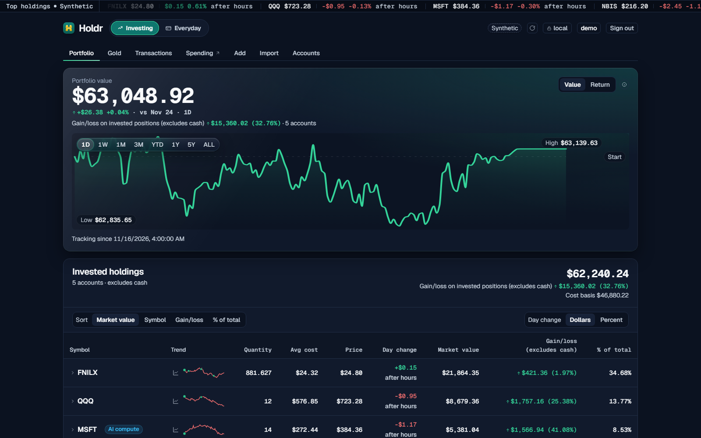
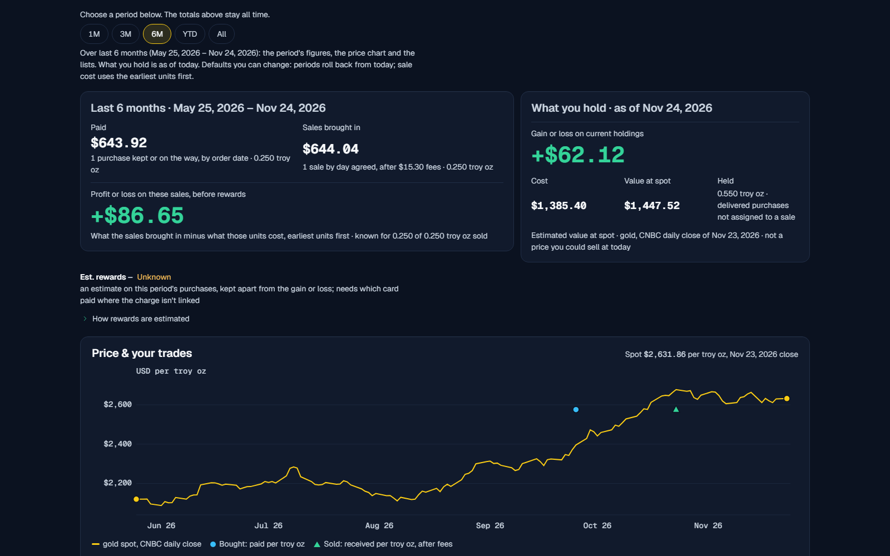
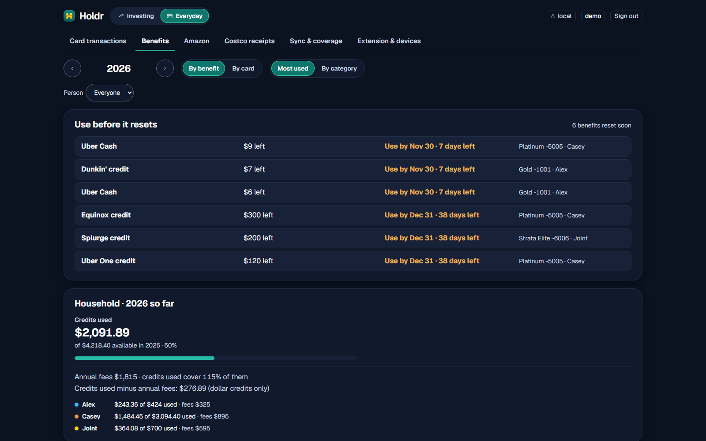
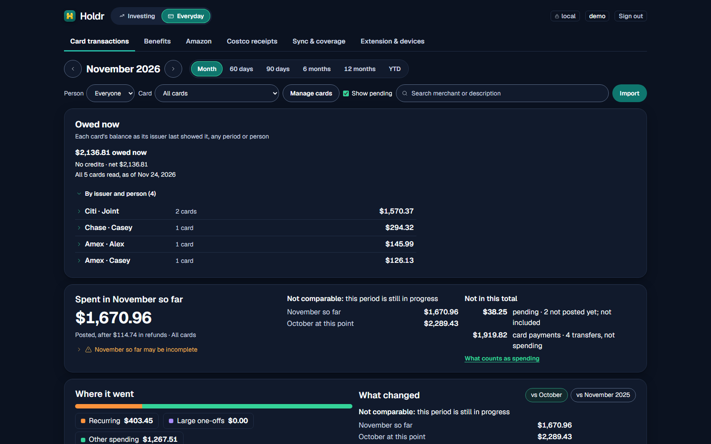
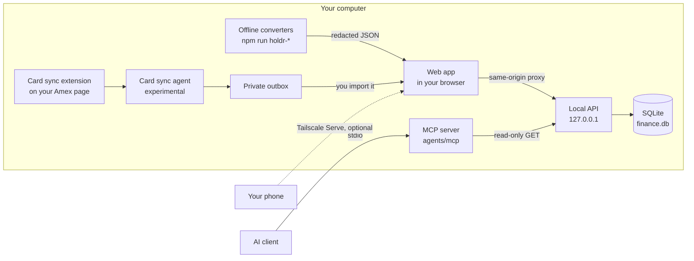

<p align="center">
  <picture>
    <source media="(prefers-color-scheme: dark)" srcset="docs/assets/brand/banner-dark.svg">
    <source media="(prefers-color-scheme: light)" srcset="docs/assets/brand/banner-light.svg">
    
  </picture>
</p>

<p align="center"><b>Humans click. Agents read.</b><br>A private, local-first finance hub for U.S. households.</p>

<p align="center">
  <a href="#try-the-demo-in-2-minutes">Demo</a> ·
  <a href="docs/getting-started.md">Get started</a> ·
  <a href="#for-ai-agents">For AI agents</a> ·
  <a href="#privacy-promise">Privacy</a> ·
  <a href="docs/README.md">Docs</a>
</p>

<p align="center">
  
  
  
  
</p>

Holdr keeps a household's money in one place, on your own computer: investment and retirement accounts, physical gold
and silver, everyday card spending and checking, and the credit-card benefits you pay annual fees for. You use it in
your browser; your data stays in one SQLite file on your disk. AI agents can read the same data through a read-only MCP
server on the same computer. This repository (FinanceTracker) is Holdr's source.

## Built for U.S. households

- **Taxable and retirement accounts side by side:** brokerage, Roth and traditional IRA, 401(k) and HSA.
- **Physical gold and silver:** coins and bars by troy ounce, with optional daily spot prices.
- **Card and checking exports:** American Express, Bilt and Wells Fargo CSV, Discover statement PDFs, and the OFX, QFX
  or QBO files most U.S. banks and card issuers let you download.
- **The statement credits of premium U.S. cards**, per person: what you used, what is left, and whether the annual fee
  pays off.
- **One household, in U.S. dollars.** No sign-up and no cloud; you add the people who sign in.

## What you get

<table>
<tr>
<td width="50%" valign="top">
<h3>Investing</h3>
<p>Brokerage, IRA, 401(k) and HSA accounts in one portfolio: positions, cost basis, gains and performance from one day
to all time, with quotes for the symbols you hold.</p>

</td>
<td width="50%" valign="top">
<h3>Gold and silver</h3>
<p>The coins and bars in your dealer orders: fine-metal content in troy ounces, what you paid and, with spot prices
turned on, their value at the latest close. Getting orders in is an advanced import for now.</p>

</td>
</tr>
<tr>
<td colspan="2" valign="top">
<h3>Credit-card benefits</h3>
<p>A premium card's statement credits only pay back its annual fee if you use them. Pick each card's product (the
American Express Platinum and Gold, Chase Sapphire Preferred, Citi Strata Elite and more) and Holdr shows, for the
household and for each person:</p>
<ul>
<li><b>Used and reimbursed:</b> each credit period, with the statement credits that paid it back.</li>
<li><b>Still unclaimed:</b> what is left of each monthly, quarterly, half-yearly, yearly or multi-year credit, and the date it resets.</li>
<li><b>Fees against value:</b> this year's credits used against the credits available and the annual fees.</li>
</ul>

</td>
</tr>
<tr>
<td width="50%" valign="top">
<h3>Everyday spending and checking</h3>
<p>Card transactions from your issuers' exports, with categories and your own rules, comparisons with earlier periods,
and card payments matched to the checking debits that paid them.</p>

</td>
<td width="50%" valign="top">
<h3>Forecasts</h3>
<p>This month's pace and projected total, the next three months of everyday spending by category with ranges, the
recurring bills coming up, and unusual charges.</p>
<h3>Imports that preview first</h3>
<p>Every import shows what it will add, finds duplicates, and refuses what it cannot verify instead of guessing.</p>
</td>
</tr>
</table>

## Privacy promise

> [!IMPORTANT]
> Holdr has no cloud, no account to create and no telemetry. Your data stays in one SQLite file on your computer.

- **One file on your disk.** `finance.db` in a per-user folder (`%LOCALAPPDATA%\Holdr\data` on Windows,
  `~/Library/Application Support/Holdr/data` on macOS), created readable by your account only.
- **Nothing listens on your network.** The web app and the API answer on `127.0.0.1` only. To use your phone, publish
  Holdr to your own tailnet with Tailscale Serve; never with Funnel.
- **Only public market data goes out:** quotes and price history for the ticker symbols you hold and, if you turn them
  on, gold and silver spot prices; never an account, an amount or your identity. The demo runs offline.
  [Details](docs/getting-started.md#where-your-data-lives).
- **No bank passwords.** Holdr never logs in to your bank or broker: you download exports and convert them offline.
- **No telemetry, no analytics,** not even in the build: the repository's scripts turn Turborepo's telemetry off.
- **Agents only read, and only on this computer.** If you connect a cloud AI client, what it reads goes to that provider.

## Try the demo in 2 minutes

You need [Node.js 22 and Git](docs/getting-started.md#1-install-nodejs-22-and-git). Clone into a folder of your own,
such as `src`, not straight into your home folder (Holdr keeps your private files in `~/Holdr`, and `holdr` and `Holdr`
are the same name on Windows and macOS). `<repository-url>` is the HTTPS address under **Code** on this page.

Windows (PowerShell; in Windows PowerShell 5.1, first run
`Set-ExecutionPolicy -Scope CurrentUser -ExecutionPolicy RemoteSigned` once so that `npm` runs):

```powershell
New-Item -ItemType Directory -Force "$env:USERPROFILE\src" | Out-Null
Set-Location "$env:USERPROFILE\src"
git clone <repository-url> holdr
Set-Location holdr
npm ci
npm run demo
```

macOS (zsh):

```zsh
mkdir -p ~/src && cd ~/src
git clone <repository-url> holdr
cd holdr
npm ci
npm run demo
```

Open <http://localhost:5174> and sign in as `demo` with the password it prints. The demo is a fictional household with
synthetic data, in its own folder and on its own ports (web `5174`, API `4001`); it runs offline and never touches your
data. Press **Ctrl+C** to stop it, and `npm run demo -- --reset` starts it over. The first start on a new day makes the
demo data again for that day (`--keep-data` keeps it; see [Each new day](docs/demo.md#each-new-day)).
[The demo](docs/demo.md) has a tour.

## Use it with your own data

In the checkout, create your sign-in (it asks for a password twice) and start Holdr (same in PowerShell and zsh):

```powershell
npm run holdr-user -- add <your-name>
npm run start:local
```

Open <http://127.0.0.1:5173> and sign in. Your data folder is created readable by you only. [Getting started](docs/getting-started.md)
walks through everything step by step for Windows and macOS: installing Node.js 22, settings, getting your data in,
phone access, starting Holdr automatically, backups, upgrades, uninstalling and troubleshooting.

### Get your data in

| Data | From | How |
|---|---|---|
| Investments | trades you type in, or a holdings table you paste as JSON | the **Investing** tab |
| Card activity | American Express, Bilt and Wells Fargo CSV; OFX, QFX or QBO from any issuer; Discover statement PDFs | an offline converter, then **Spending → Import redacted JSON** |
| American Express, without downloads 🧪 | the [card sync agent](docs/sync-agent.md) and its browser extension | redacted files in a private outbox, imported the same way |
| Checking | CSV, OFX, QFX, QBO and supported statement PDFs | an offline converter, then `npm run holdr-checking` |
| Gold and silver (advanced) | order captures from Costco, Walmart and CollectPure | `holdr-metals-convert`, then `npm run holdr-metals` |
| Costco receipts (advanced) | receipt captures | `holdr-retail-convert`, then `npm run holdr-retail` |

Statement files never go to the web app: a converter turns them into redacted JSON on your computer first. Every import
previews first and finds duplicates, and importing the same file twice adds nothing. [Importing data](docs/importing-data.md)
has every command for both shells. 🧪 marks experimental.

## For AI agents

Humans use the web app. AI agents read the same local data through Holdr's **read-only MCP server** (`agents/mcp`),
with tools for your portfolio, positions and investment activity, gold and silver, card spending and transactions, card
benefits and forecasts. It runs next to Holdr on your computer, talks to your AI client over standard input and output,
and sends only `GET` requests to Holdr's API on `127.0.0.1`: it cannot change, import or delete anything.

With Holdr or the demo running, check the setup from the checkout (`--demo` reads the demo instead of your data):

```powershell
npm run mcp -- --demo --check
```

Then add the server to your client. The examples read your own data; to read the demo instead, add `--demo` after the
path (in JSON, `"--demo"` as a second argument). Use your checkout's full path: `(Resolve-Path agents\mcp\server.mjs).Path`
in PowerShell, `echo "$PWD/agents/mcp/server.mjs"` in zsh. If you installed Node.js with fnm, AI clients do not find
its `node`: use the full path that `fnm exec --using=22 node -p process.execPath` prints instead of `node` (in JSON,
with each `\` doubled).

<details>
<summary><b>GitHub Copilot CLI</b></summary>

Windows (PowerShell; quote the `--`, which PowerShell drops before a Copilot CLI installed with npm):

```powershell
copilot mcp add holdr '--' node C:\Users\you\src\holdr\agents\mcp\server.mjs
```

macOS (zsh):

```zsh
copilot mcp add holdr -- node /Users/you/src/holdr/agents/mcp/server.mjs
```

</details>

<details>
<summary><b>VS Code (GitHub Copilot)</b></summary>

Copilot in VS Code reads the same `~/.copilot/mcp-config.json` as Copilot CLI (`%USERPROFILE%\.copilot\mcp-config.json`
on Windows), and a `.mcp.json` at a workspace's root (Git ignores it in this repository). On macOS:

```json
{
  "mcpServers": {
    "holdr": {
      "type": "stdio",
      "command": "node",
      "args": ["/Users/you/src/holdr/agents/mcp/server.mjs"]
    }
  }
}
```

On Windows, write the path as `"C:\\Users\\you\\src\\holdr\\agents\\mcp\\server.mjs"`.

</details>

<details>
<summary><b>Claude Desktop</b></summary>

**Settings → Developer → Edit Config** opens `claude_desktop_config.json` (in `%APPDATA%\Claude` on Windows,
`~/Library/Application Support/Claude` on macOS). Quit and restart Claude Desktop after editing it. Windows:

```json
{
  "mcpServers": {
    "holdr": {
      "command": "node",
      "args": ["C:\\Users\\you\\src\\holdr\\agents\\mcp\\server.mjs"]
    }
  }
}
```

On macOS, Claude Desktop does not read your shell's `PATH`, so `command` is the full path that `which node` prints
(`/opt/homebrew/opt/node@22/bin/node` with Homebrew's `node@22`, `/usr/local/bin/node` with the nodejs.org installer):

```json
{
  "mcpServers": {
    "holdr": {
      "command": "/opt/homebrew/opt/node@22/bin/node",
      "args": ["/Users/you/src/holdr/agents/mcp/server.mjs"]
    }
  }
}
```

</details>

<details>
<summary><b>Cursor</b></summary>

Use `~/.cursor/mcp.json` (`%USERPROFILE%\.cursor\mcp.json` on Windows) for every project, or `.cursor/mcp.json` in one
project (Git ignores it in this repository). On macOS:

```json
{
  "mcpServers": {
    "holdr": {
      "type": "stdio",
      "command": "node",
      "args": ["/Users/you/src/holdr/agents/mcp/server.mjs"]
    }
  }
}
```

On Windows, write the path as `"C:\\Users\\you\\src\\holdr\\agents\\mcp\\server.mjs"`.

</details>

Things to ask:

- "Which statement credits expire this month, and which have I already used?"
- "How much have our card credits paid back against the annual fees this year, per person?"
- "What's our net worth across brokerage, Roth IRA, 401(k) and HSA, and how much of it is tax-advantaged?"
- "How is our gold doing against what we paid for it?"
- "Are we spending more than usual this month? Which bills are coming up?"

What a tool returns becomes part of the conversation, so a cloud AI client sends it to its provider; keep a session that
reads Holdr free of tools that can publish (web, e-mail). [Use Holdr with AI agents](docs/agents.md) covers every tool,
the security model and what agents cannot see. AI coding agents working on this repository start with
[AGENTS.md](AGENTS.md), and [llms.txt](llms.txt) maps the docs for language models.

## How it fits together



- The web app reaches the API through its own server's proxy, so your browser talks to one address.
- The MCP server and the card sync agent read Holdr's API on `127.0.0.1` only; neither opens a port to your network.
- Imports that need more than a file upload (checking, gold and silver, receipts) run as commands that take a backup
  first and write only under an authorization file you write.

[Architecture and limitations](docs/architecture.md) explains the parts.

## Platforms

| | Windows 10/11 | macOS |
|---|---|---|
| Demo, and your own data (`npm run demo`, `npm run start:local`) | ✅ | ✅ |
| Development (`npm run dev`) | ✅ | ✅ |
| Your phone and other devices over private HTTPS (Tailscale Serve) | ✅ | ✅ |
| Backups; card, statement and checking imports | ✅ | ✅ |
| MCP server for AI agents | ✅ | ✅ |
| Card sync agent (American Express) | 🧪 | 🧪 |
| Gold and silver, Costco receipts | advanced | advanced |
| Hardened deployment (immutable releases, lifecycle locks) | — | advanced |

The launcher, the demo and the MCP server have so far run end to end on Windows; on macOS, their folders, permissions
and paths are covered by unit tests. Linux is untested. [What runs where](docs/getting-started.md#what-runs-where) has
the details.

## Using Holdr from your phone or another computer

Holdr never listens on your network. [Tailscale Serve](https://tailscale.com/kb/1312/serve) gives the computer that
runs it a private HTTPS address that only the devices signed in to your tailnet can open: start Holdr with
`npm run start:local -- --https-origin https://<machine>.<tailnet>.ts.net`, then publish it once with
`tailscale serve --bg --https=443 http://127.0.0.1:5173` (on macOS the `tailscale` command is inside the Tailscale app,
and on Windows it may need an administrator PowerShell once; step 6 shows both). Never use `tailscale funnel`, which
would put Holdr on the public internet. [Getting started, step 6](docs/getting-started.md#6-use-holdr-from-your-phone-or-another-computer)
has every step for Windows and macOS.

## Documentation

| Guide | |
|---|---|
| [Getting started](docs/getting-started.md) | Install, sign-in, start, imports, phone access, auto-start, backups and restore, upgrades, uninstalling, troubleshooting |
| [The demo](docs/demo.md) | The synthetic household and what to look at |
| [Importing data](docs/importing-data.md) | Every converter and importer, for both shells |
| [Use Holdr with AI agents](docs/agents.md) | The read-only MCP server and client setup |
| [Card sync agent](docs/sync-agent.md) | The experimental American Express receiver |
| [Deployment](docs/deployment.md) | Every setup, the settings reference, every error code |
| [Architecture and limitations](docs/architecture.md) | How the parts fit and where the boundaries are |
| [All documentation](docs/README.md) | The full index, advanced guides included |

## Status and known limitations

- **The browser extension in `apps/extension` cannot connect as shipped:** it has no bank adapters, and the hardened
  `dist` mode it needs stays closed until a supported Tailscale build is pinned in the code. Use file import or the card
  sync agent instead.
- **The card sync agent is experimental:** American Express only, posted U.S. dollar transactions only, and it can stop
  working when the bank's site changes.
- **One household, in U.S. dollars.** Card spending, benefits and forecasts know three owners, two people and joint,
  shown as Alex, Casey and Joint; the names cannot be changed yet. Everyone who can sign in sees and can change all of
  the household's data: there are no roles.
- **No bank connections:** you download exports yourself. Gold and silver and receipt imports need capture folders
  from tools that are not part of this repository.
- **The Gold page's all-time profit or loss reads "unavailable"** (Bought and Sold say "history unverified"): Holdr
  shows it only once it can verify that your purchase history is complete, and that check is not built yet. The
  period's figures, your holdings and the charts work.
- **Restore is manual** ([Getting started, step 8](docs/getting-started.md#8-back-up-and-restore)). Linux is untested.

### Roadmap

Planned, in no particular order and without dates:

- **All-time results for gold and silver:** a list you confirm of where you buy and sell metals, so that Holdr can
  verify your purchase history and show the Gold page's all-time profit or loss.
- **Your own household names** instead of Alex and Casey.
- **Node.js 24,** once Holdr's SQLite module ships prebuilt binaries for it.
- **More platforms tested end to end:** the launcher, the demo and the MCP server on macOS, and Linux.

## Getting help

Start with [Troubleshooting](docs/getting-started.md#troubleshooting). For a bug or a question, open an issue in this
repository's **Issues** tab with your operating system, `node --version`, the command you ran and the message it
printed. Never attach real statements, exports, databases, tokens or screenshots of real data, and write paths as
`C:\Users\you` or `/Users/you`. Report security problems privately, as [SECURITY.md](SECURITY.md) describes.

## Contributing

See [CONTRIBUTING.md](CONTRIBUTING.md). Use synthetic data only: never commit exports, statements, databases,
screenshots of real data, tokens or personal details; `npm run privacy:scan` checks what you stage. AI coding agents
follow [AGENTS.md](AGENTS.md).

## Security

Report vulnerabilities privately, as [SECURITY.md](SECURITY.md) describes. Keep the API on `127.0.0.1`, reach Holdr
from other devices only through Tailscale Serve (never Funnel, port forwarding or a public server), and keep the data
folder, the backups and `.env` private to your account.

## License

[MIT](LICENSE).

Holdr is an independent open-source project. It is not affiliated with, endorsed by or sponsored by any bank,
brokerage, card issuer, retailer or data provider named here; their names and trademarks belong to their owners. Holdr
and its documentation are not financial, investment, tax or legal advice.
